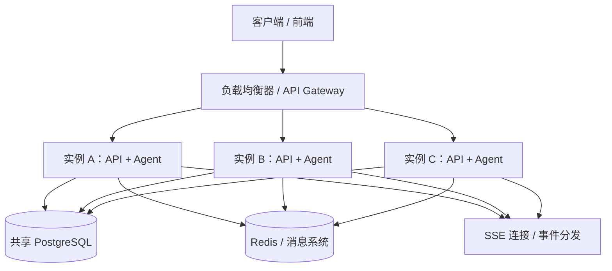
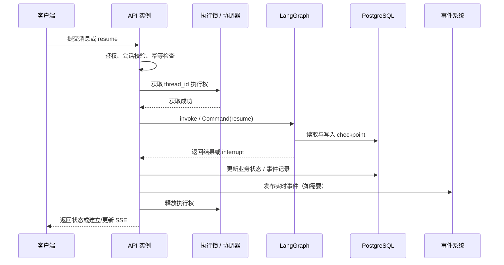

# LangGraph 多实例部署：Interrupt 与 Checkpoint 可靠性设计

## 1. 核心结论

LangGraph 的 `interrupt` 与 `checkpoint` 部署到多实例后，最核心的问题是：

> 同一个 `thread_id` 可能被不同实例处理，但恢复必须基于一致的持久化状态，并且不能让多个实例同时推进同一条工作流。

建议优先落实三个原则：

1. **共享持久化 checkpoint**：所有实例使用同一套 PostgreSQL 等持久化 checkpointer。
2. **同一线程串行执行**：同一个 `thread_id` 的图执行与恢复请求需要协调，避免并发推进。
3. **外部工具调用幂等**：checkpoint 恢复并不保证业务副作用只执行一次。

此外，还需要处理 SSE 连接与执行状态解耦、恢复请求鉴权、版本兼容、故障恢复和可观测性。

---

## 2. 推荐架构



### 设计原则

- **Agent 状态不依赖单个实例的进程内存**。
- 所有实例访问同一套持久化 checkpoint 存储。
- 同一 `thread_id` 的执行必须经过并发协调。
- SSE 连接对象属于具体进程，不能通过 checkpoint 自动恢复。
- Redis Pub/Sub 可用于实时通知，但不能单独承担不可丢失事件的持久化职责。

---

## 3. 多实例必须注意的 7 个问题

### 3.1 同一个 `thread_id` 不能并发执行

#### 风险

例如，同一会话等待用户补充运单号：

1. 实例 A 收到用户提交的运单号。
2. 实例 B 因重复提交、请求重试或其他请求，也收到同一会话的恢复请求。
3. 两个实例可能读取同一 checkpoint 并同时恢复图执行。
4. 可能导致重复调用工具、状态竞争、重复转人工或业务状态不一致。

共享 PostgreSQL 只能让实例读取同一份持久化状态，并不自动保证同一线程的执行互斥。

#### 解决方案

对同一 `thread_id` 的图执行进行串行化，可以考虑：

- Redis 分布式锁；
- PostgreSQL advisory lock 或其他数据库锁；
- 按 `thread_id` 分区、同一分区串行消费的消息队列；
- 独立的执行协调服务。

示意代码：

```ts
async function resumeAgent(
  threadId: string,
  resumeValue: unknown,
) {
  return withThreadLock(threadId, async () => {
    return graph.invoke(
      new Command({ resume: resumeValue }),
      {
        configurable: {
          thread_id: threadId,
        },
      },
    );
  });
}
```

`withThreadLock` 是应用层需要实现的并发控制，不是 LangGraph 内置 API。

#### 锁的注意事项

- 只在实际图执行期间持锁，不要在等待用户补充参数的整个时间段一直持锁。
- 设计合理的锁租约、续租和超时策略。
- 释放锁时验证唯一 token，避免删除其他实例持有的锁。
- 考虑实例崩溃、锁过期、旧持有者继续执行等情况。
- 对高风险写操作使用幂等键；高可靠场景还应考虑 fencing token 或数据库侧的并发校验。

> 分布式锁可以减少并发冲突，但不能单独保证外部业务操作只执行一次。

### 3.2 Checkpoint 必须使用共享持久化存储

| 存储方式                     | 多实例表现                            |
| ---------------------------- | ------------------------------------- |
| 实例 A 的进程内存            | 只有实例 A 能访问该内存状态           |
| 实例 B 的进程内存            | 无法读取实例 A 的状态                 |
| 共享 PostgreSQL checkpointer | 各实例可以访问同一份持久化 checkpoint |

所有实例应使用一致的 checkpointer 配置，并正确传入：

- `thread_id`；
- 需要时使用的 checkpoint namespace；
- 恢复时所需的 checkpoint 标识（若采用指定历史 checkpoint 的恢复方式）。

还要关注：

- 数据库连接池和连接数上限；
- checkpoint 保留和清理策略；
- 备份、恢复与故障切换；
- checkpointer 依赖版本与 LangGraph 版本兼容性。

`MemorySaver` 适合本地开发和演示，不应被当作跨进程重启的持久化存储。

### 3.3 Redis 分布式锁不能只写 `SETNX`

可以使用带唯一 token 和过期时间的锁，例如：

```text
SET agent:lock:{thread_id} {unique_token} NX PX 30000
```

但仍需实现：

- 执行较长时的续租；
- 释放锁时校验 token；
- 获取锁失败后的等待、排队或重试策略；
- 实例崩溃后的租约过期；
- 锁过期后旧实例仍在运行时的保护措施；
- 请求幂等和业务侧并发校验。

单纯执行 `SETNX` 后再 `DEL` 不够安全，因为锁可能已经过期并被另一个实例重新获取。

如果采用 PostgreSQL advisory lock，也要明确锁的作用域、连接生命周期和事务边界，并评估长时间执行对数据库连接的占用。

### 3.4 SSE 连接与 Agent 执行要解耦

假设用户的 SSE 连接建立在实例 A 上，但后续恢复请求被负载均衡到实例 B。

实例 B 可以恢复 Agent，却无法直接操作实例 A 进程内的 HTTP `res` 对象。

常见方案：

**方案 A：连接与执行绑定**

- Agent 在实例 A 执行时由 A 推送 SSE。
- 客户端断线后重新建立连接。
- 重连后通过会话 ID 查询当前状态或补取可恢复事件。

**方案 B：事件分发**

- 执行实例产生 token、状态变化和工具调用事件。
- 将事件发布到 Redis 或消息系统。
- 持有 SSE 连接的实例订阅并转发事件。

Redis Pub/Sub 适合实时通知，但消息可能在订阅者离线时丢失。如果事件不可丢失，应使用持久化事件表、支持持久化消费的消息队列，或其他可重放机制。

推荐将以下概念分开管理：

- Agent 图执行状态；
- 会话业务状态；
- SSE 连接状态；
- 可重放的会话事件。

### 3.5 外部工具调用需要幂等

#### 典型故障

1. Agent 调用转人工接口。
2. 业务系统成功创建人工客服会话。
3. Agent 进程在 checkpoint 更新前崩溃。
4. 新实例恢复后再次执行转人工调用。
5. 可能创建重复的客服会话。

#### 处理方式

为有副作用的操作设计业务幂等键，例如：

```text
handoff:{conversationId}:{requestId}
```

由业务服务持久化并校验幂等键，重复请求返回首次操作结果，而不是再次执行创建操作。

适用场景包括：

- 创建人工客服会话；
- 下单、扣款、发货；
- 发送通知或邮件；
- 修改业务状态；
- 调用无法撤销的外部 API。

需要认识到：checkpoint 记录图的执行状态，并不能与外部业务系统的副作用天然构成一个原子事务。必要时可以使用事务性 Outbox、业务幂等、状态对账和补偿机制。

### 3.6 恢复请求需要校验业务状态

不要允许客户端仅凭 `thread_id` 任意恢复工作流。

服务端至少要校验：

- 当前用户是否有权访问该会话；
- 会话是否处于等待输入、等待审批或允许恢复的状态；
- 本次 resume 请求是否已处理过；
- 当前等待的输入类型是什么，提交数据是否符合预期；
- 会话是否已关闭或已经转人工；
- 恢复操作是否与当前执行版本兼容。

`thread_id` 是工作流定位标识，不是身份认证凭证。

建议将会话状态明确建模，例如：

```text
RUNNING
WAITING_FOR_INPUT
WAITING_FOR_APPROVAL
HANDED_OFF
COMPLETED
FAILED
CANCELLED
```

具体状态枚举应根据业务流程调整，并通过数据库事务或并发控制保证状态迁移合法。

### 3.7 多实例部署要考虑版本兼容

滚动发布时，实例 A 可能使用新版 State，而实例 B 仍在运行旧版代码。两个版本可能读取同一 checkpoint。

如果新版修改了 State 字段、节点名称、interrupt 位置或恢复逻辑，旧 checkpoint 可能无法按预期恢复。

建议：

- 让新旧版本在发布窗口内尽可能兼容 checkpoint 结构；
- 对 State 变更设计版本字段和迁移策略；
- 对长期挂起会话保留兼容恢复路径；
- 监控恢复失败率、挂起时长、节点异常和 checkpoint 读取错误；
- 不随意删除仍存在未完成会话的 checkpoint；
- 对不兼容的流程变更采用显式迁移、旧版本恢复或人工处理策略。

---

## 4. 推荐的请求处理流程



### 重要的事务边界

图中的业务状态写入、checkpoint 写入和事件发布未必处于同一个原子事务中。因此应：

- 对重复请求做幂等处理；
- 对业务状态迁移做条件更新或事务保护；
- 对不可丢失的事件使用事务性 Outbox 或持久化消息机制；
- 明确失败后的重试、对账和补偿策略。

具体调用顺序应按系统设计调整。例如，如果 Agent 执行时间较长，不应在整个模型调用期间持有长时间的数据库事务。

---

## 5. 物流客服 Agent 的存储建议

| 数据                                     | 建议存储位置                 | 原因                                   |
| ---------------------------------------- | ---------------------------- | -------------------------------------- |
| Agent State、消息状态、待执行节点        | LangGraph checkpointer       | 支持图状态持久化与恢复                 |
| 中断时等待的输入或审批信息               | checkpoint；必要时同步业务表 | 恢复执行，并支持业务查询               |
| 客服会话状态、`humanAgentId`、接待人信息 | PostgreSQL 业务表            | 业务状态需要独立查询和维护             |
| SSE 连接对象、HTTP `res`                 | 对应 Node.js 实例内存        | 连接属于进程，不能通过 checkpoint 恢复 |
| 会话列表和用户会话关系                   | 业务数据库                   | 鉴权、列表查询和生命周期管理           |
| 锁、限流数据、短期缓存                   | Redis 或其他协调系统         | 跨实例协调和快速访问                   |
| 可重放的消息/token/状态事件              | 持久化事件表或消息队列       | 支持断线补发、审计和故障排查           |

不要将所有业务数据都塞进 checkpoint。Checkpoint 主要服务于图执行恢复；业务数据库应作为客服会话等业务事实的可靠来源。

---

## 6. 上线前检查清单

### 状态与恢复

- [ ] 所有实例连接同一套持久化 checkpointer。
- [ ] 恢复请求使用正确的 `thread_id` 和 checkpoint 配置。
- [ ] 进程重启后能够恢复已持久化的挂起会话。
- [ ] 已测试长时间挂起、恢复失败和 checkpoint 清理策略。

### 并发与幂等

- [ ] 同一 `thread_id` 的图执行具备串行化机制。
- [ ] 锁有租约、续租、可靠释放和异常退出策略。
- [ ] 恢复请求具有幂等标识。
- [ ] 转人工、下单等副作用操作有业务幂等保护。
- [ ] 已测试重复提交、并发 resume、锁过期和实例崩溃。

### SSE 与事件

- [ ] SSE 连接不依赖某个实例永久存活。
- [ ] 客户端重连后能查询当前会话状态。
- [ ] 需要可靠送达的事件可以持久化和补发。
- [ ] 已定义事件 ID、断线后的补发规则和重复事件处理方式。

### 业务与发布

- [ ] 恢复前执行鉴权和状态校验。
- [ ] `thread_id` 不被当作鉴权凭证。
- [ ] State、节点与 interrupt 变更有兼容策略。
- [ ] 具备恢复失败率、挂起时长、工具重试、锁等待时间等监控。
- [ ] 已演练实例重启、数据库暂时不可用及滚动发布场景。

---