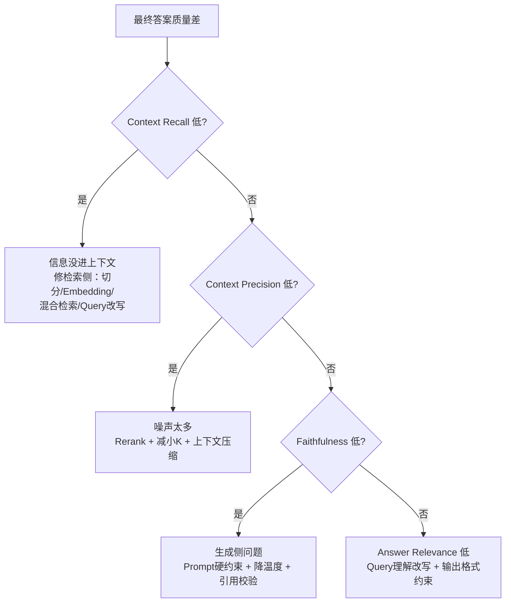

# RAG 指标异常排查指南：从归因到优化的实战手册

> RAG 系统上线后，指标不达预期是最常见的问题。检索召不回、上下文有噪声、回答有幻觉、延迟压不下来——每一类问题都有对应的排查路径。本文按指标逐一拆解：指标低可能是什么原因、如何定位、如何优化，并给出一张可直接套用的诊断决策树。

## 一、核心定位思路

RAG 链路可以抽象为五段：**切分 → 向量化 → 检索 → 重排 → 生成**。排查指标问题时有一条黄金法则：

> **下游指标低时先看上游指标，逐层归因。**

生成质量差，先看上下文质量；上下文质量差，先看检索质量。不要一上来就改 prompt，那很可能在修一个不存在的问题。

## 二、检索质量指标

### 2.1 Recall@K 低（相关内容没被召回）

**可能原因**

- Chunk 切分不当：切太碎导致语义不完整，切太大导致向量表示被稀释
- Embedding 模型与领域不匹配（通用模型遇上专业术语、代码、多语言场景）
- Query 与文档表述差异大（文档是书面语，用户问的是口语）
- 索引问题：文档未入库、更新延迟、向量化时字段缺失

**如何定位**

- 构建评测集（query → 标准相关 chunk），跑离线评测，观察 K 从小到大（Recall@5 → @10 → @20）的变化：
  - K 调大后 Recall 明显上升 → 排序有问题，相关内容在后面
  - K 调大也不涨 → 根本没召回，问题在索引 / 切分 / embedding
- 人工抽查 badcase：搜索目标答案所在的 chunk，看它是否在库里、向量相似度排名多少

**如何优化**

- 调整切分策略：按语义 / 标题切分、加 chunk overlap、父子 chunk（小块检索、大块返回）
- 换领域 embedding 模型，或对领域数据微调
- 加**混合检索**（BM25 + 向量），解决关键词精确匹配问题（型号、错误码类 query 尤其有效）
- Query 改写 / 扩展：HyDE、多路 query 生成

### 2.2 Hit Rate 低

与 Recall@K 同源（只要 Top-K 里命中一个就算），定位方式相同。区别是 Hit Rate 低说明**经常全军覆没**，通常问题更靠前：

- 优先检查：文档是否真的入库、metafilter 是否误过滤（如时间、权限、租户过滤条件写错）
- 检查 query 预处理：拼写纠错、同义词归一化是否反而改错了语义

### 2.3 MRR 低（召回了，但排名靠后）

**可能原因**

- 召回没问题，**排序能力不足**：向量相似度 ≠ 真实相关性
- 多个相似 chunk 竞争，噪声内容排前面
- 向量索引量化 / 压缩（如 PQ、HNSW 的 ef 参数过低）损失了精度

**如何定位**

- 对比 Recall@K 和 MRR：Recall 高但 MRR 低 → 纯排序问题，方向明确
- 看相关 chunk 的实际排名分布，如果稳定在 5~20 名 → 加重排收益会很大

**如何优化**

- 加 **Reranker**（cross-encoder，如 bge-reranker、cohere-rerank）：粗排召回 Top 50，精排取 Top 5，这是对 MRR / NDCG 最有效的单点优化
- 调 HNSW 参数（ef_search 调大）、避免过度量化
- 利用元数据加权：时间新鲜度、来源权威度做排序融合

### 2.4 NDCG 低（排序整体质量差）

与 MRR 类似但考虑所有相关文档的位置，原因和优化同上，补充两点：

- **定位**：如果只有 1 个相关文档的场景 MRR 正常、多相关文档场景 NDCG 低 → 是「多个相关结果之间的相对排序」问题，rerank 同样有效
- **优化**：可用 LLM 做列表级重排（rankGPT 思路），或积累点击 / 反馈数据训练 LTR 模型

## 三、上下文质量指标

### 3.1 Context Precision 低（噪声太多）

**可能原因**

- 上游检索排序差（通常伴随 MRR / NDCG 低）
- Top-K 取太大，把边缘相关 / 不相关内容都塞给了 LLM
- Chunk 太大，一个 chunk 里只有小部分相关

**如何定位**

- 看 Context Precision 和检索指标是否同时低：
  - 是 → 修检索
  - 否（检索指标正常）→ 是「组装上下文」的策略问题（K 值、去重、压缩）
- 人工看实际送进 prompt 的内容，评估信噪比

**如何优化**

- Rerank 后取更小的 K（如 rerank 50 → 取 3~5）
- 上下文压缩：LLMLingua、提取相关性句子而非整块返回
- 去重与合并：多路召回的重复 chunk 合并

### 3.2 Context Recall 低（需要的信息没进上下文）

**可能原因**

- 根因基本都在检索侧（同 Recall@K 低的原因）
- 例外情况：检索到了但**组装时被截断**（token 限制把关键内容挤掉了）

**如何定位**

- 先确认 ground truth 信息在不在库里 → 不在是数据 ingestion 问题
- 在库里但 Context Recall 低 → 检索 / 排序问题
- 检索到了但没进最终 prompt → 上下文组装 / 截断问题

**如何优化**

- 同 Recall@K 的优化（混合检索、query 改写、切分优化）
- Context Recall 低会直接导致 Faithfulness / 答案准确率低，**这是生成质量问题的首要排查对象**

## 四、生成质量指标

### 4.1 Faithfulness 低（答案不忠实，幻觉）

**可能原因**

- 上下文里根本没有答案（Context Recall 低），模型靠参数知识硬编 → **最常见**
- 上下文有答案但被噪声淹没，模型没抓到
- Prompt 问题：没有强约束「仅根据上下文回答」
- 模型本身幻觉倾向强、温度太高

**如何定位**

- **交叉对比 Context Recall 和 Faithfulness**：
  - Context Recall 低 + Faithfulness 低 → 修检索，别动 prompt
  - Context Recall 高 + Faithfulness 低 → 生成侧问题
- 逐条 badcase 标注：答案里的每个 claim 能否在 context 中找到出处

**如何优化**

- Prompt 加硬约束：「仅基于以下资料回答，资料中没有则明确说不知道」，并要求带引用
- 降低 temperature
- 加 citation 校验环节（生成后验证 claim 有出处）
- 上下文质量差时宁可拒答，不硬答

### 4.2 Answer Relevance 低（答非所问、太啰嗦）

**可能原因**

- Query 理解偏差：多轮对话中指代消解失败（「那第二个呢？」没改写成完整问题）
- Prompt 指令不清：没约束回答格式 / 长度
- 检索内容偏题，模型顺着错误材料跑偏
- 输出过长、绕圈子，稀释了相关性

**如何定位**

- 看中间产物：改写后的 query 是否忠于原意？检索内容是否切题？答案风格是否符合预期？
- 区分两类 case：答案方向错了（query 理解 / 检索问题）vs 方向对但废话多（prompt / 后处理问题）

**如何优化**

- 多轮场景做 query 重写（结合历史做指代消解）
- Prompt 明确回答格式：「直接回答问题，不超过 X 句」
- 加输出后处理，或让 LLM 自评相关性、不合格则重试

## 五、系统性能指标

### 5.1 P50 / P99 延迟高

**可能原因**

- 链路串行太长：embedding → 检索 → rerank → LLM 逐段累加
- LLM 生成长文本是延迟大头；P99 高通常是长尾 query 触发了大上下文
- 向量库索引不适合数据规模（暴力扫描、HNSW 参数不当）
- 冷启动、网络往返多

**如何定位**

- **全链路打点**，拆分各阶段耗时（embedding / 检索 / rerank / LLM 首 token / LLM 生成），看大头在哪
- 区分 P50 和 P99：P50 高是普遍慢，P99 高是长尾（特定 query、特定租户、GC、限流重试）

**如何优化**

- LLM 阶段：流式输出（体感延迟大幅下降）、缩小上下文、用小模型做简单 query 路由
- 检索阶段：缓存高频 query 的检索结果和 embedding
- 架构：embedding 并行、rerank 只对 top 候选做、设置各阶段超时与降级（rerank 超时就用粗排结果）

### 5.2 QPS 低 / Token 成本高

**可能原因**

- QPS：下游 LLM 是瓶颈、无缓存、单实例吞吐低
- Token 成本：塞给 LLM 的上下文太长（Top-K 太大、chunk 太大）、多轮对话历史无限累积、重试放大

**如何定位**

- 压测找瓶颈层（LLM API 限流？向量库？应用层？）
- 成本：按阶段统计 token 消耗，通常 90% 以上在 LLM 的 input token

**如何优化**

- 缓存：语义缓存（相似 query 直接返回缓存答案）
- 上下文瘦身：更小的 K、上下文压缩、对话历史摘要化
- 分级路由：简单 query 用小模型 / 纯检索，复杂 query 才上大模型
- 批处理与并发优化（rerank、embedding 支持批量）

## 六、诊断决策树

**三条核心原则：**

1. **自上而下归因**：生成指标低先看上下文指标，上下文指标低先看检索指标
2. **建评测集先行**：没有带标注的评测集（query → golden chunks → golden answers），一切优化都是盲调
3. **单点验证**：每次只改一个环节（如只加 rerank），用指标确认收益再叠加，可用 Ragas / TruLens 等框架做持续回归评测

## 参考资料

- [RAG 性能指标与优化实践](rag-performance.md 'RAG 性能指标与优化实践') —— 各指标的定义与计算方式
- [如何提高 RAG 性能指标](如何提高RAG性能指标.md '如何提高 RAG 性能指标')
- [RAG 检索增强生成](rag.md 'RAG 检索增强生成')
- [Ragas 评测框架](https://docs.ragas.io/)
